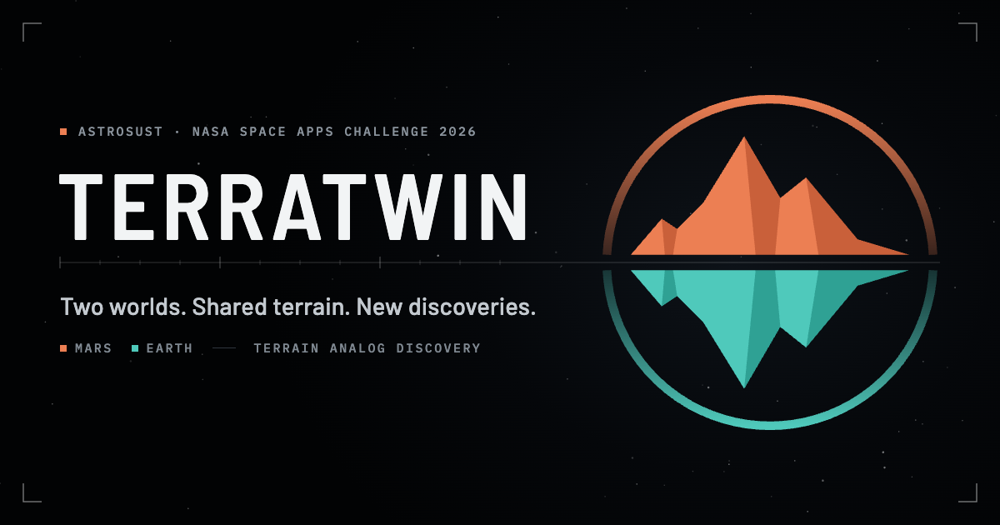

<p align="center"></p>

# TerraTwin

**Two Worlds. Shared Terrain. New Discoveries.**

AstroSUST's NASA Space Apps Challenge 2026 entry. TerraTwin is an interactive Mars–Earth terrain-analog
discovery tool:

1. Pick any location on a 3D Mars.
2. Read its measured terrain characteristics and MOLA observation support.
3. Screen all of Earth's land surface (249,165 coarse cells) for comparable terrain.
4. Refine shortlisted Earth windows with **Observation-Operator Matching (OOM)**: Earth is compared as
   NASA's MOLA altimeter would have observed it at that Mars site.
5. See where each analogy holds and where it breaks down, then export a characterization report.

The scientific method is research-stage. Its benefit was shown on **synthetic terrain twins only**. It has not been
validated against field data or expert review. The UI states this wherever a score appears.

Live: https://terratwin-five.vercel.app (frontend on Vercel; API and GIS data on an AWS Lightsail host, see
[docs/deployment.md](docs/deployment.md)).

## AI assistance (Use of Super Intelligence)

This project was built with substantial AI assistance, disclosed here as the 2026 rules require:

- **Research package** (`TerraTwin_AstroSUST_research_package.zip`: the OOM method, experiments, synthetic-twin
  benchmark, research code in `apps/api/vendor/terratwin` and its data products) was produced in AI-assisted
  research sessions (Claude Science).
- **Application code** (`apps/web`, `apps/api`), the **GIS pipeline** (`fahim-tech/terratwin-dataset`: Mars feature
  extraction, discovery jobs, 1 km grids and the six Mars factors), deployment scripts, documentation and the
  logo/icon artwork were written with AI coding assistants (Claude Code), directed by the AstroSUST team.
- **No measurements were generated by AI.** Every measured value comes from the cited NASA, USGS and ESA datasets
  and is processed by the code above. The benchmark's synthetic terrain twins are computed by the research code and
  are labelled synthetic wherever they appear.

What was verified, and how: automated tests (API `pytest`, web `vitest`), SHA-256 checks of the research package
on every API start, reproduction of the research tables by the live code (`test_tier1_reproduces_research_specificity_table`),
the G5 contract rules enforced server- and client-side, and a scripted browser journey against production
(`apps/web/scripts/e2e-journey.mjs`). The team chose the scope, reviewed the results and is responsible for the
submission. The method itself has **not** been reviewed by external experts or validated in the field.

```
apps/web     React + Vite + TypeScript + Tailwind + CesiumJS (isolated Mars/Earth globe iframes)
apps/api     FastAPI + Pydantic; vendored research engine in apps/api/vendor/terratwin
scripts/     import_research_package.py (verified, allow-listed import of the research ZIP)
contracts/   API contract for the GIS and science teams
docs/        research integration status, deployment
```

## Run locally

Prerequisites: Node 20+, Python 3.11+, [uv](https://docs.astral.sh/uv/), and `TerraTwin_AstroSUST_research_package.zip`.

```bash
python3 scripts/import_research_package.py ~/Downloads/TerraTwin_AstroSUST_research_package.zip
```

```bash
cd apps/api && uv sync && uv run uvicorn terratwin_api.main:app --port 8000
```

```bash
cd apps/web && npm install && cp .env.example .env && npm run dev
```

Open http://localhost:5180. Tests:

```bash
cd apps/api && uv run pytest -q
```

```bash
cd apps/web && npm test && npm run build
```

## Environment variables

| Variable | Where | Purpose |
|---|---|---|
| `VITE_API_BASE_URL` | web | API base URL (default `http://127.0.0.1:8000`) |
| `VITE_CESIUM_ION_TOKEN` | web | Optional. Enables Cesium Mars 3D Tiles (asset 3644333) and Cesium World Terrain. Without it, NASA Trek / GIBS imagery is used. The ion path has not been exercised in testing. |
| `TERRATWIN_DATA_DIR` | api | Imported research data (default `apps/api/data/research`) |
| `TERRATWIN_MEGDR_COUNTS_DIR` | api | MEGDR 128 ppd counts tiles (GIS). Unset → live OOM unavailable |
| `TERRATWIN_MOLA_MOSAIC` | api | USGS MOLA 463 m mosaic path (GIS). Unset → arbitrary Mars features unavailable |
| `TERRATWIN_GIS_PROVIDER` | api | `module:function` implementing live refinement (see `contracts/api-contract.md`) |
| `TERRATWIN_CORS_ORIGINS` | api | Comma-separated allowed origins |
| `TERRATWIN_CORS_LOCALHOST` | api | `1` (default) allows any localhost port; set `0` in production |

See [docs/research-integration.md](docs/research-integration.md) for what is wired, pending and blocked, and
[docs/deployment.md](docs/deployment.md) for deployment.
